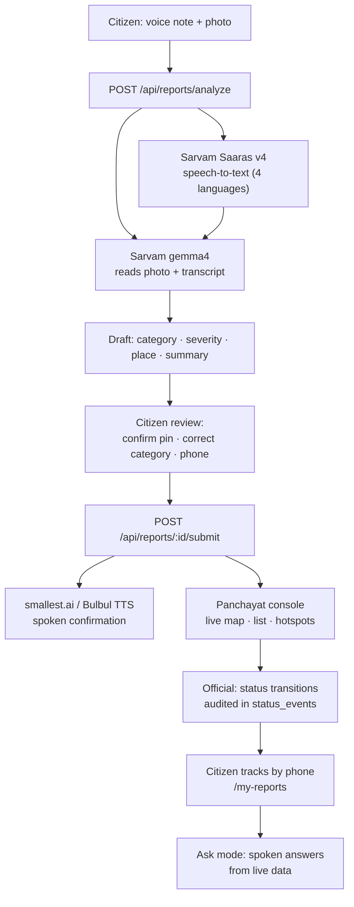
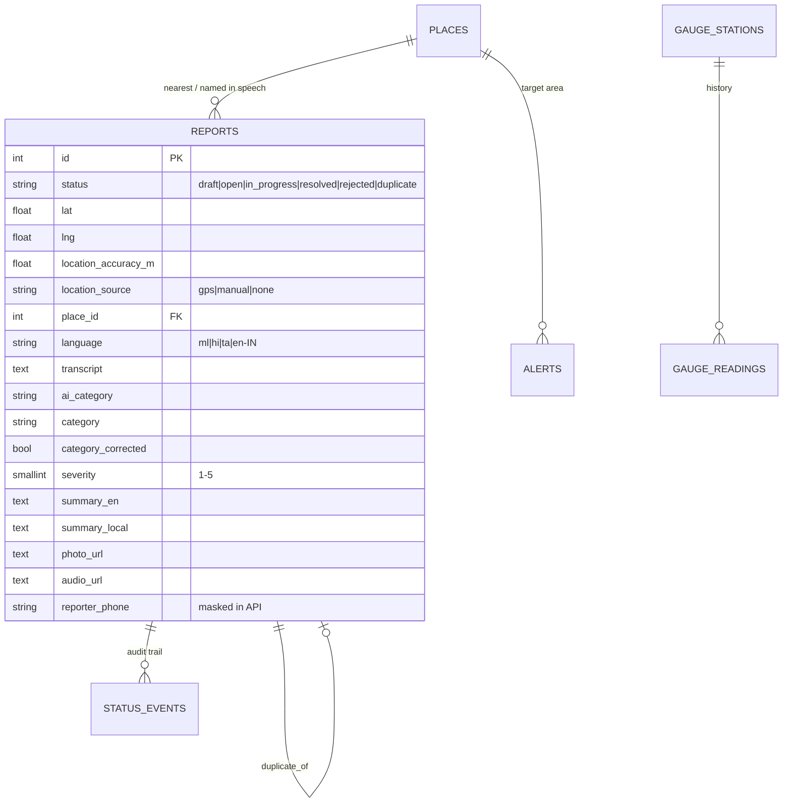

# Kayal (കായൽ)

**Your voice. Our waters. Together.**

Multilingual voice + photo reporting for the Alappuzha backwaters — citizens speak a problem, the panchayat sees it on a live map. Built solo at **HackaThoni 2026**.

**Live demo:** https://kayal.akshitsharma.dev — citizen app at `/report`, panchayat console at `/dashboard`
**Source:** https://github.com/akshitsharmacodes/hackathoni-kayal
**Spec:** [docs/PRD.md](docs/PRD.md) · **Devin tasks:** [docs/devin-tickets.md](docs/devin-tickets.md)
**Deployed:** Vercel (frontend) → Render (API) → Supabase (Postgres + Storage)

---

## The problem

Alappuzha (Kerala) lives on its backwaters — the Vembanad–Kol wetland, a Ramsar site, and the below-sea-level farms of Kuttanad. Water hyacinth chokes canals, plastic and oil collect, and floods arrive fast in a district below sea level.

The people who see these problems first are fishers and boat crews — on the water, in a hurry, speaking Malayalam, Hindi or Tamil. Today's channels don't fit them: a phone call with no location, a WhatsApp forward that gets buried, or an e-governance portal built around typed English forms. Reports lose their location, cluster information is invisible to officials, and the citizen never hears back.

## What Kayal does

**For citizens** (`/report`) — one action per screen, every step spoken back:

1. **Speak** — tap one big button and describe the problem in Malayalam, Hindi, Tamil or English. Add a photo if you like.
2. **Exact pin** — GPS fix within 30 m, or drag the pin by hand. No report is ever saved with a guessed location.
3. **AI sorts it** — Sarvam AI transcribes the voice, reads the photo, and assigns a category and severity — which the citizen can correct with one tap.
4. **Send** — the report lands on the panchayat console within seconds, and a spoken reply confirms the complaint number.

**For the panchayat** (`/dashboard`):

- Live map of every report — exact pin, photo, and the citizen's own voice clip
- Hotspots, likely duplicates, and severity to decide where to send the team first
- Insights: daily volume, categories, status mix
- Broadcast alerts that Kayal reads aloud to anyone who asks

**Ask mode** (`/ask`): any citizen can ask by voice — *"is the water rising near me?"* — and get a spoken answer grounded in recent reports, rainfall and river-gauge readings (demo data, labelled as such).

## Feature checklist

**Citizen app**

- Voice reporting in Malayalam, Hindi, Tamil and English — one big button, one action per screen
- Photo attach (resized on-device before upload)
- Truthful locations: GPS accepted only at ≤ 30 m accuracy, else a hand-placed pin; `location_source` is stored on every report
- AI draft — category, severity 1–5, place, local-language summary — with one-tap citizen correction
- Spoken confirmation with complaint number + "what happens next"
- Track complaints by phone number (`/my-reports`)
- Ask mode: spoken Q&A grounded in live reports, gauges and active alerts
- Language picker, time-of-day greeting, helpline, light/dark themes, installable PWA manifest

**Panchayat console**

- Live Leaflet map on neutral tiles — category-coloured pins, severity, photos, the original voice note
- Reports list with detail sheet; status workflow `open → in_progress → resolved | rejected | duplicate`
- Duplicate detection: likely duplicates flagged, officials can link reports
- Insights: daily volume, category and status mix, top hotspots
- Area alerts with radius, severity and expiry — read aloud to citizens in Ask mode
- River-gauge overlay (demo stations, labelled `is_demo`) with warning/danger thresholds
- Collapsible icon-rail sidebar, app switcher, theme toggle

**Engineering**

- Two-phase draft → submit: photo/audio upload runs in parallel with STT + classification, saving ~3–4 s on boat internet
- Reporter phone numbers normalised, masked in API responses, never exposed raw
- Place resolution: village names found in speech (alias table) win over nearest-place geometry, within a 3 km trust radius
- Full status audit trail (`status_events` on every transition)
- Alembic migrations incl. RLS policies; smoke test for the whole API surface
- Seed data: 30 reports over 7 days in 4 languages

## Report workflow



## Data model



## Voice + AI stack

| Job | Service | Model / voice |
|---|---|---|
| Speech-to-text | Sarvam AI | **Saaras v4**, language-hinted per UI language |
| Report classification | Sarvam AI | **gemma4** — vision: reads the photo + transcript, returns strict JSON |
| Ask-mode answers | Sarvam AI | **sarvam-105b-conversations**, grounded in live report/gauge/alert context |
| TTS (primary) | smallest.ai | **Lightning v3.1 Pro** (Malayalam, `parvathy`) / **v3.1** (en·hi·ta, `srishti`) |
| TTS (fallback) | Sarvam AI | **Bulbul v3** (`priya`) — any smallest.ai failure falls back automatically |

## Architecture

```
Citizen phone (mic, camera, GPS)
        │  voice note + photo + pin
        ▼
Next.js 16 app on Vercel ──────────► FastAPI on Render (/api proxy)
  React 19 · Tailwind                  Sarvam AI: STT + classification + QA
  shadcn/ui · TanStack Query           smallest.ai: TTS replies
  Leaflet / OpenStreetMap              SQLAlchemy + Alembic
        │                                   │
        └────────────── Supabase Postgres + Storage (photos/audio)
```

## Design

Linear/Vercel-style precision rebuilt for civic use: hairline grids, Geist + Geist Mono, off-white `#FAFAF7`, backwater green `#1E5B3A` — colour carries meaning only (green = action, monsoon orange = alerts/"open", category colours on the map). Light and dark themes throughout, mobile-first.

## Deployment

- **Frontend** — Vercel, `frontend/` as project root, `BACKEND_URL` pointing at the API
- **Backend** — Render web service defined in [`render.yaml`](render.yaml): `uv sync` build, `alembic upgrade head` on deploy, health check at `/api/health`
- **Domain** — `kayal.akshitsharma.dev` (CNAME → Vercel); HTTPS required for mic/camera on phones

## Scope & upcoming features

Kayal is a working end-to-end product, not a mock. What comes next, in priority order:

- **Verified identity** — OTP login for citizens; phone lookup is unverified in this demo
- **SMS / WhatsApp notifications** — status updates without a smartphone or an app install
- **Real gauge + weather feeds** — swap demo gauges for CWC/IMD/KSDMA data
- **Offline reporting** — queue voice + photo on the boat, sync when the network returns
- **Field-team app** — assign reports to workers, upload resolution photos
- **Escalation + SLAs** — panchayat → district routing with time-bound status
- **K-SMART integration** — push reports into Kerala's official LSGD complaint system
- **Geofenced push alerts** — notify only the wards inside an alert's radius
- **Auto language detection** — skip the picker; detect from the voice note itself
- **Multi-panchayat rollout** — one deployment per local body with shared place data

## Stack

| Layer | Tech |
|---|---|
| Frontend | Next.js 16, React 19, Tailwind 4, shadcn/ui, TanStack Query, Leaflet |
| Backend | FastAPI, SQLAlchemy 2, Alembic, Pydantic |
| Data | Supabase Postgres + Storage (local SQLite/`uploads` fallback) |
| AI | Sarvam AI (Saaras STT, gemma4, 105B QA, Bulbul TTS), smallest.ai Lightning TTS |
| Build | Devin (bounded side tasks), `uv`, npm |

## Run locally

```powershell
# backend (first time: fill backend/.env, see below)
cd backend
uv sync
uv run alembic upgrade head
uv run python -m scripts.seed --reset
uv run uvicorn app.main:app --reload --port 8000
```

```powershell
# frontend
cd frontend
npm install
npm run dev
```

Open http://localhost:3000 (landing), `/report` (citizen app), `/dashboard` (panchayat console), `/about` (developer).

### backend/.env

| Key | Notes |
|---|---|
| `SARVAM_API_KEY` | required |
| `SMALLEST_API_KEY` | TTS primary; Sarvam is used if empty |
| `DATABASE_URL` | Supabase **session pooler** URI with `postgresql+psycopg://` prefix. Empty = local SQLite (dev only) |
| `SUPABASE_URL`, `SUPABASE_SERVICE_KEY` | Storage uploads (public buckets `report-photos`, `report-audio`). Empty = local `uploads/` (dev only) |
| `SMALLEST_VOICE_EN/HI/TA` | optional smallest.ai voice ids; Malayalam defaults to `parvathy` |

### Phone demo (HTTPS needed for mic + camera)

```powershell
cloudflared tunnel --url http://localhost:3000
```

Open the printed `https://….trycloudflare.com/report` on the phone.

### Smoke test

```powershell
cd backend; uv run python tests/smoke.py            # direct
$env:API="http://localhost:3000/api"; uv run python tests/smoke.py   # through the Next.js proxy
```

## Repo layout

```
frontend/   Next.js app — landing, citizen app, panchayat console
  app/        routes: / (landing), /report, /ask, /my-reports, /language, /dashboard/*, /about
  components/ landing story, citizen, dashboard, brand, ui (shadcn)
backend/    FastAPI service
  app/        routers (reports, ask, alerts, gauges, stats), services (sarvam, tts, geo, storage)
  alembic/    migrations · scripts/ seed · tests/ smoke
docs/       PRD.md (full product spec + decisions log), devin-tickets.md
```

## Sponsors

- [Sarvam AI](https://www.sarvam.ai) — speech-to-text, classification, fallback TTS
- [smallest.ai](https://smallest.ai) — primary text-to-speech
- [Devin](https://devin.ai) — bounded side tasks during the build
- [TinkerHub](https://tinkerhub.org) — community

## Developer

**Akshit Sharma** — designed and built Kayal solo at HackaThoni 2026.

[akshitsharma.dev](https://akshitsharma.dev) · [GitHub](https://github.com/akshitsharmacodes) · [LinkedIn](https://www.linkedin.com/in/akshitsharmacodes) · akshitsharmacodes@gmail.com

---

Built with heart in India.
